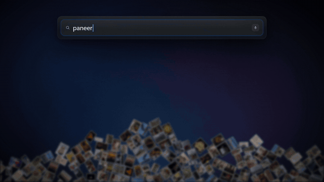

<p align="center">
  
</p>

<h1 align="center">Glimpse</h1>

<p align="center">
  <b>Search your Windows PC by meaning. Privately.</b><br>
  Press <kbd>Alt</kbd>+<kbd>Space</kbd> and describe what you're looking for: a photo, a PDF, a voice note,
  a moment in a video, a Windows setting. The AI runs on your own PC. Nothing is uploaded.
</p>

<p align="center">
  <a href="docs/launch.mp4"></a><br>
  <a href="docs/launch.mp4"><b>▶ Watch the launch video (1:24)</b></a>
</p>

---

## Why

You remember *what's in* a file, not what you named it. `IMG_4021.jpg`, `Scan0003.pdf` and
`Recording (12).m4a` don't help. Glimpse understands the content itself (text, pictures, speech
and video), so you can just ask for it:

| You type | You get |
|---|---|
| `receipt from the sushi dinner` | The photo of the receipt. Text *inside* images is matched, no OCR |
| `wifi keeps disconnecting` | The right Windows settings and fixes, plus a live check of your Wi-Fi and internet |
| `my screen is too dim` · `no sound from speakers` | Display or Sound settings, with a **live brightness or volume slider** right in the results |
| `voice note about the electricity bill` | The recording, found by **what was said**, opened at that moment |
| `how much notice before I move out` | Page 2 of the lease PDF, with the matching sentence |
| `my vaccine certificate` | A **scanned** PDF, found by what's printed on the page |
| `mountains and a lake` | Photos, and the **moment in a video** where the lake appears (opens at 2:41) |
| `photos from last weekend` · `latest pdf` | Date and file-type words become filters |
| `function that finds duplicate photos` | `dedupe.py`, found by what the code does |
| `gemini api key` | The `.env` file that holds it, with the key **masked** on screen and a *Copy key* button |
| `party popper` · `rupee sign` | Emoji and symbols, click to copy |
| *(Ctrl+M and speak)* | Voice search, transcribed locally |
| *(paste or drop an image)* | Visually similar photos and video moments |

It also works in Hinglish and many other languages, and inside File Explorer it can search **just the folder
you're in** (including subfolders), like Explorer's own search box.

## Install

**Windows 10 or 11, 64-bit.** No admin rights needed. Open **PowerShell** and paste:

```powershell
irm https://raw.githubusercontent.com/Ayushmaniar/glimpse/main/install.ps1 | iex
```

That's it. The installer:
1. gets [uv](https://docs.astral.sh/uv/) and a private Python 3.12 (nothing is installed system-wide),
2. installs the packages (~400 MB) and downloads the search model (485 MB, [EmbeddingGemma 2](https://huggingface.co/litert-community/embeddinggemma-2-740m-litert-lm), Apache-2.0),
3. adds **Glimpse** to the Start Menu, turns on *Start with Windows*, and starts it.

Everything lives in `%LOCALAPPDATA%\Glimpse`. Prefer not to pipe a script into PowerShell?
[Download the ZIP](https://github.com/Ayushmaniar/glimpse/archive/refs/heads/main.zip), unzip it anywhere,
and double-click **`install.bat`**.

**Hardware.** Any PC with a DirectX 12 GPU (NVIDIA, AMD or Intel) runs the model on the GPU; others use
the CPU automatically (slower indexing, searches still well under a second). Voice search uses Whisper
*large-v3-turbo* on NVIDIA GPUs and the smaller *base* model elsewhere. Plan for ~2 GB of disk for the app,
plus the index (roughly 1% of the size of what it indexes).

**Windows on ARM** isn't supported yet: the model runtime ships for x64 only.

## Using it

| Key | Does |
|---|---|
| <kbd>Alt</kbd>+<kbd>Space</kbd> | Show / hide Glimpse (falls back to <kbd>Ctrl</kbd>+<kbd>Shift</kbd>+<kbd>Space</kbd> if another app owns it) |
| <kbd>↑</kbd> <kbd>↓</kbd> <kbd>←</kbd> <kbd>→</kbd> · <kbd>Enter</kbd> | Move · open |
| <kbd>Shift</kbd>+<kbd>Space</kbd> | Quick Look: PDF pages, photos, the video frame, the passage in a document |
| <kbd>Ctrl</kbd>+<kbd>Enter</kbd> | Show in folder |
| <kbd>Ctrl</kbd>+<kbd>1</kbd>…<kbd>9</kbd> | Jump to a section |
| <kbd>Ctrl</kbd>+<kbd>M</kbd> | Voice search |
| <kbd>Tab</kbd> | Opened from File Explorer: switch between *this folder* and *This PC* |
| <kbd>Esc</kbd> | Close the preview, clear the query, hide |

Drag the empty space around the search box to move the window; double-click it to re-centre.

**What gets indexed:** Documents, Desktop, Downloads, Pictures, Videos and Music (OneDrive folders too),
files changed in the last 90 days first, newest first. Searching works from the first minute; the full first
index can take a few hours on a big library and pauses on battery. After that, new and changed files are
picked up within seconds. The tray icon (bottom-right) shows progress and has *Pause indexing*,
*Start with Windows*, *Open log* and *Quit*.

## Privacy

- **Nothing leaves your PC.** The model, the index and voice transcription all run locally. Network use is
  limited to downloading the models (on install, and the voice model on your first voice search) and, only when
  you ask about Wi-Fi or internet problems, a connectivity check for the live network card: a DNS lookup of
  `www.msftconnecttest.com` (the same check Windows itself does) and a connect-and-close to `1.1.1.1` to time
  the latency. No query, file or file name is ever sent anywhere.
- The search window talks to a local server on `127.0.0.1` that requires a random per-session token, so web
  pages can't query it.
- **Browser and terminal history are off** by default (opt in via settings).
- API keys and passwords found in files are **masked** in results (`AIza••••••5Gh`), so they don't show up
  on a screen share.
- The index (`.data\` in the install folder) holds text extracted from your files. Uninstalling deletes it.

## Settings

Edit `%LOCALAPPDATA%\Glimpse\.data\settings.json` (created on first run; only the keys you change are stored):

```json
{
  "folders": ["C:\\Users\\you\\Documents", "D:\\Photos"],
  "sources": { "browser_history": true, "shell_history": false },
  "hotkey": ["ctrl+shift+space"],
  "voice_language": "en",
  "backend": "auto"
}
```

`voice_language` skips language detection (faster on CPU). `backend`: `auto`, `gpu` or `cpu`. All options
with their defaults are in [`glimpse/config.py`](glimpse/config.py).

## Uninstall

```powershell
powershell -ExecutionPolicy Bypass -File "$env:LOCALAPPDATA\Glimpse\uninstall.ps1"
```

This removes the app, its model, its index, the Start Menu shortcut and the startup entry. Your files are never touched.

## Troubleshooting

- **Alt+Space does nothing:** another app (e.g. PowerToys Run) may own it. Glimpse then uses
  Ctrl+Shift+Space; the tray menu shows which hotkey is active.
- **No window appears:** Glimpse needs the Microsoft Edge WebView2 runtime, which ships with Windows 11
  and current Windows 10. Install it from [Microsoft](https://developer.microsoft.com/microsoft-edge/webview2/) if needed.
- **"Model failed to load":** set `"backend": "cpu"` in settings.json and restart from the Start Menu.
- **Anything else:** the log is at `%LOCALAPPDATA%\Glimpse\.data\glimpse.log`. Please
  [open an issue](https://github.com/Ayushmaniar/glimpse/issues) with the relevant lines.

## How it works

Glimpse embeds text, images, video frames and speech into **one shared vector space** with Google's
[EmbeddingGemma 2](https://huggingface.co/google/embeddinggemma-2) (740M parameters, open weights) running
through [LiteRT-LM](https://github.com/google-ai-edge/LiteRT-LM), so a sentence can find a photo or a moment
in a recording directly, without captions or transcripts. Documents use a **hybrid** of embeddings and BM25
keyword search (SQLite FTS5), fused by reciprocal rank, so exact names and IDs are found too. Each kind of
result (photos, documents, settings, …) is ranked and cut by its own measured noise floor, and sections are
ordered by how well they match what you asked for.

The full design, every threshold and the evaluations behind them are in
**[docs/HOW-IT-WORKS.md](docs/HOW-IT-WORKS.md)**.

## Development

```powershell
git clone https://github.com/Ayushmaniar/glimpse; cd glimpse
.\install.bat                                              # sets up .venv and the model in place
.venv\Scripts\python.exe -m glimpse.app --browser     # no window: prints a URL to open
.venv\Scripts\python.exe -m tests.test_ranking            # also: test_scope, test_time, test_fresh, test_secrets, ...
```

The UI is plain HTML/CSS/JS in `glimpse/ui/` (open `index.html` from disk for a mock-data version).
The launch video is code too: see [`video/`](video/README.md).

## Credits & license

Glimpse is [MIT licensed](LICENSE). It builds on EmbeddingGemma 2 (Google, Apache-2.0) via LiteRT-LM,
[faster-whisper](https://github.com/SYSTRAN/faster-whisper) (MIT) with OpenAI Whisper weights (MIT),
[pywebview](https://pywebview.flowrl.com/), [SQLite FTS5](https://www.sqlite.org/fts5.html), PDFium
(via pypdfium2), FFmpeg (via imageio-ffmpeg) and other open-source packages listed in `requirements.txt`.
